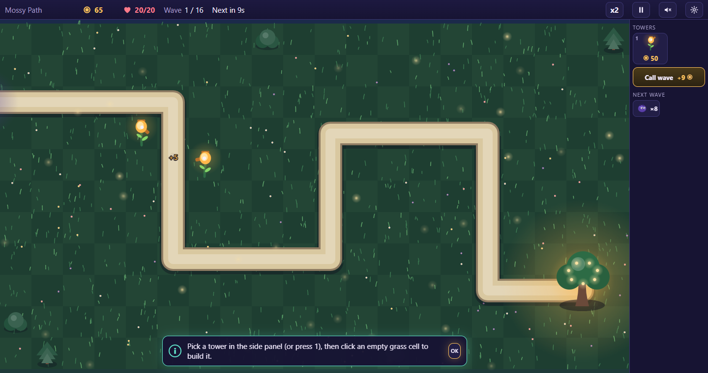
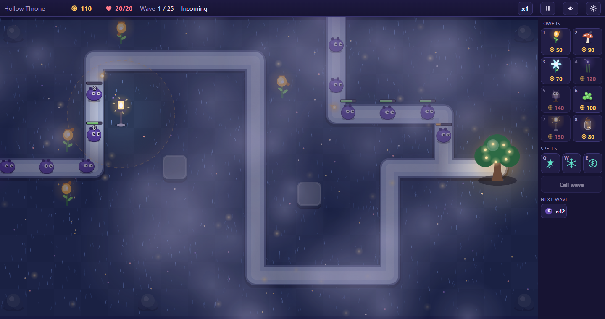

# Lumen Hollow

A night-forest tower defense for the browser. Shadows of the Hollow crawl along forest paths toward
the Heart-tree; you light the way with lantern towers. Twelve campaign levels across four biomes,
eight towers with branching upgrades, four bosses, three spells, a talent grove and an endless
mode. Everything you see and hear is drawn and synthesized by code: no image, font or audio files.

**Play:** `https://<your-user>.github.io/<repo>/` (after enabling GitHub Pages, see below)



## Screens

- **Title** with drifting fireflies, Campaign, Endless Night (unlocks after level 12), The Grove and Settings.
- **Campaign map**: 12 levels in 4 biomes with stars; each level card lists what is new there.
- **In game**: the 1280 x 720 forest on the left, a top bar (gold, lives, wave, countdown, speed,
  pause, sound) and a side panel (towers, spells, next-wave preview, call-wave button, selected tower card).
- **Results**: stars, time, kills, gold earned and spent, leaks, towers, spells, and damage per tower type.
- **The Grove**: a 12-node talent tree paid for with stars.



## Controls

| Action | Mouse / touch | Keyboard |
| --- | --- | --- |
| Pick a tower | click a tower button | `1`–`8` |
| Build | click a highlighted cell (touch: tap twice) | hold `Shift` to keep building |
| Select tower | click it | |
| Upgrade / sell | buttons on the tower card | `U` / `S` |
| Next wave (early = bonus gold) | Call wave button | `Space` |
| Spells | spell buttons | `Q` Starfall, `W` Frost Nova, `E` Gold Rush |
| Cancel | right click | `Esc` |
| Pause | pause button | `P` (or `Esc` with nothing selected) |
| Game speed x1 / x2 / x3 | speed button | `F` |

Each tower has a targeting mode: first, last, strongest or closest.

## Towers

Every tower has two plain upgrades and a third, irreversible upgrade where you pick one of two branches.
Selling returns 70% of everything spent on the tower.

| Tower | Cost | Role | Branches |
| --- | --- | --- | --- |
| Sparkshooter | 50 | fast physical shots, ground and air | Rapid (double fire rate) / Heavy (25% crits x3) |
| Boomcap | 90 | mushroom mortar, splash, ground only | Cluster (extra blasts) / Big Bang (bigger radius, stun) |
| Frostbloom | 70 | magic frost, slows by 35% | Deep Freeze (chance to freeze) / Blizzard (frost pulses) |
| Storm Reed | 120 | chain lightning, magic, hits air | Overload (6 jumps) / Static (marked foes take +20%, no shield regen) |
| Owl Perch | 140 | long-range sniper | Eagle Eye (ignores half the armour) / Hunter (x2 vs flyers and bosses) |
| Mold Garden | 100 | stacking poison clouds, ground only | Plague (poison spreads on death) / Acid (melts armour) |
| Beacon Lantern | 150 | aura: +damage, +range, reveals the invisible | Radiance (+attack speed) / Warding (immune to Darkness) |
| Firefly Jar | 80 | gold at the start of each wave (max 5) | Harvest (more gold) / Bounty (gold per nearby kill) |

Physical damage is reduced by flat armour (minimum 1); magic ignores armour.

## Enemies and bosses

| Enemy | Trait |
| --- | --- |
| Shade Grunt | the steady walker |
| Dusk Runner | fast and fragile |
| Swarmling | tiny, comes in packs of 8–14 |
| Bark Tank | slow, armoured, costs 2 lives |
| Gloom Moth | flies straight to the tree, ignoring the path |
| Mender | mends nearby shadows |
| Splitter | bursts into three swarmlings |
| Shieldbearer | regenerating shield after 4 s without damage |
| Phantom | invisible until it passes near a tower or a Beacon |

| Boss | Level | Mechanic |
| --- | --- | --- |
| Big Grub | 3 | releases swarmlings every 25% of health lost |
| Mire Mother | 6 | summons slimes, leaves a hastening puddle when it dies |
| Stone Colossus | 9 | heavy armour that cracks at 66% and 33%, speeding it up |
| Hollow King | 12 | shield phase, phantom phase, then Darkness that shuts towers down |

## Campaign

| Biome | Levels | New things |
| --- | --- | --- |
| The Meadow | 1–3 | tutorial, two entrances, build pads only, Big Grub |
| The Marsh | 4–6 | flyers, Starfall, swamp pits, healers, Mire Mother |
| The Cliffs | 7–9 | forking path, splitters, Frost Nova, boulders to clear, Gold Rush, high ground, Stone Colossus |
| Dusk Wood | 10–12 | fog, shieldbearers, a two-path gauntlet, phantoms, the Hollow King |

Stars: 1 for a win, 2 for keeping at least 70% of your lives, 3 for winning on Hard.
Difficulties: Calm, Normal, Hard. After level 12, **Endless Night** opens with optional
challenge modifiers (swift, armoured, poor, fragile, no spells, horde).

## Development

Requirements: Node.js 20+.

```bash
npm install
npm run dev        # local dev server
npm run build      # static build in dist/
npm run preview    # serve the build
npm run typecheck
npm run lint
npm test           # unit tests (simulation, data, saves)
npm run sim        # headless balance simulator
npm run smoke      # browser smoke test (uses an installed Edge; set PW_CHANNEL=chrome for Chrome)
```

`npm run sim` plays every level on every difficulty with an idle bot and a greedy builder bot and
prints win rates, lives left, duration and damage share per tower. Options: `--seeds 10`,
`--level 7`, `--diff normal,hard`, `--only spark` (single-tower builds).

### Project layout

```
src/
  core/     deterministic simulation (no DOM): game loop, towers, enemies, damage, waves, bosses
  data/     all balance tables: towers, enemies, levels, waves, spells, talents, difficulty
  render/   Canvas 2D renderer with procedural art
  ui/       DOM screens, HUD, input and the main loop
  audio/    WebAudio synthesized sound effects and music
  i18n/     English and Russian strings
  save/     versioned localStorage saves with migrations
  sim/      balance simulator
```

See [docs/ARCHITECTURE.md](docs/ARCHITECTURE.md) for details.

### Deploying to GitHub Pages

The workflow in `.github/workflows/deploy.yml` builds and publishes on every push to `main`.
In the repository settings open **Pages** and set **Source** to **GitHub Actions**.

## License

[MIT](LICENSE)

---

## По-русски

**Lumen Hollow** — браузерная tower defense в ночном лесу. Тени ползут к Сердцу-дереву, а вы
расставляете башни-фонарики. 12 уровней в четырёх биомах, 8 башен с ветвями улучшений, 4 босса,
3 заклинания, дерево талантов «Роща» и бесконечный режим «Бесконечная ночь». Вся графика и звук
создаются кодом, без внешних файлов. Игра на английском и русском (язык выбирается автоматически
и меняется в настройках).

Управление: `1`–`8` — выбор башни, клик — постройка, `U` — улучшить, `S` — продать,
`Space` — следующая волна, `Q`/`W`/`E` — заклинания, `F` — скорость, `P` — пауза, `Esc` — отмена.

Запуск: `npm install`, затем `npm run dev`. Сборка: `npm run build`. Балансный симулятор: `npm run sim`.
Лицензия MIT.
